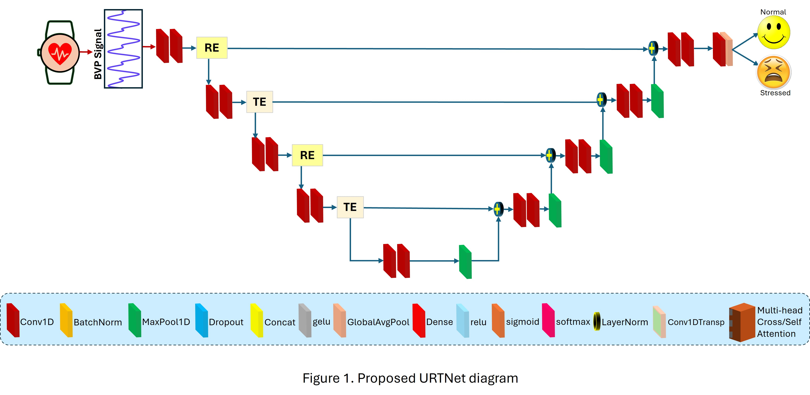
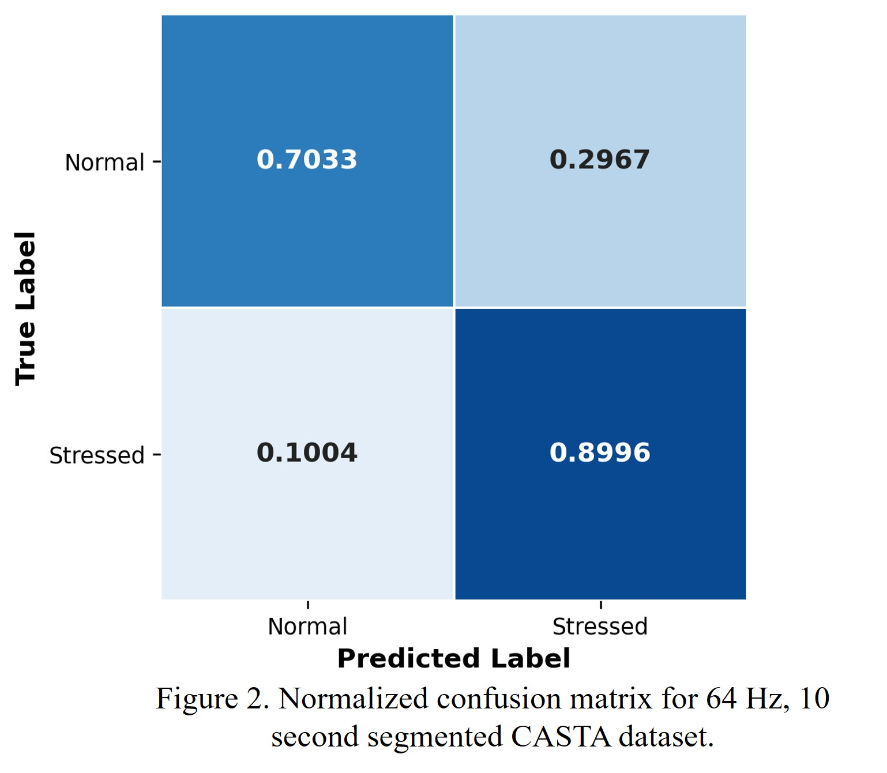
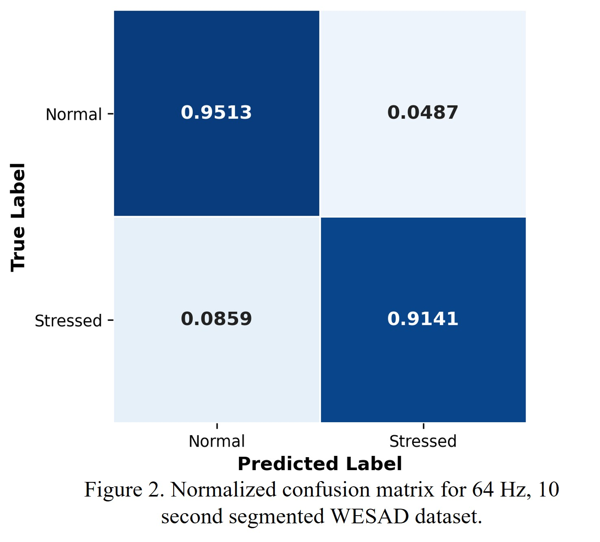

# URTNet-SPML
URTNet: Residual Encoder and Transformer Encoder Integrated 1D U-Net Model For Stress Monitoring On Resource-Constrained Platforms

## Overview

URTNet is a lightweight hybrid deep learning architecture for binary stress detection using photoplethysmography (PPG) signals. It integrates a 1D U-Net with Residual Encoder (RE) and Transformer Encoder (TE) components to learn complementary feature representations for classifying PPG signals into Normal and Stress categories.

## Datasets

- **CASTA:** PPG dataset used for stress detection.
- **WESAD:** Publicly available wearable sensor dataset used for stress detection.
- **Classification:** Binary classification — Normal (0) and Stress (1).

## Data Preprocessing

- **Sampling Frequency:** 64 Hz.
- **Segmentation:** 10-second windows (640 samples per segment).
- **Normalization:** Z-score normalization.
- **Data Splitting:** Subject-wise data splitting for independent subject evaluation.

## Proposed Model

- **Architecture:** Hybrid 1D U-Net integrated with Residual Encoder (RE) and Transformer Encoder (TE).
- **Total Parameters:** 409,226.
- **Model Size:** 1.56 MB (reported).
- **Objective:** Lightweight and efficient PPG-based stress detection for resource-constrained healthcare platforms.

### Proposed URTNet Architecture

*Figure 1. Proposed URTNet architecture integrating 1D U-Net, Residual Encoder, and Transformer Encoder.*

## Experimental Setup

- **Validation Strategy:** Leave-One-Subject-Out (LOSO) cross-validation.
- **Testing Strategy:** One subject held out for testing in each iteration.
- **Evaluation Metrics:** Accuracy, Precision, Recall, F1-score, ROC-AUC, and Cohen's Kappa.

## Experimental Results

URTNet was evaluated on the CASTA and WESAD datasets using subject-independent LOSO cross-validation.

### CASTA Dataset

- **Accuracy:** 85.06%
- **Sensitivity:** 89.96%
- **Specificity:** 70.33%
- **Cohen's Kappa:** 0.6021

*Figure 2. Normalized confusion matrix for the CASTA dataset.*

### WESAD Dataset

- **Accuracy:** 93.78%
- **Sensitivity:** 91.39%
- **Specificity:** 95.13%
- **Cohen's Kappa:** 0.8652

*Figure 3. Normalized confusion matrix for the WESAD dataset.*

## Embedded Deployment

The PPG-based stress detection research includes deployment on resource-constrained platforms:

- Raspberry Pi 3B+
- Arduino Nano BLE

## Code Availability

The associated research manuscript is currently under preparation. This repository provides an overview of the proposed URTNet architecture, datasets, preprocessing methodology, experimental setup, and research results.

The complete source code and full model implementation will be made publicly available following publication of the associated research paper.

## Copyright

Copyright © 2026 Md. Minhazul Haq. All rights reserved.

The materials in this repository are provided for research and academic reference. Reproduction, redistribution, or modification requires prior written permission from the copyright holder, except where permitted by applicable law.
